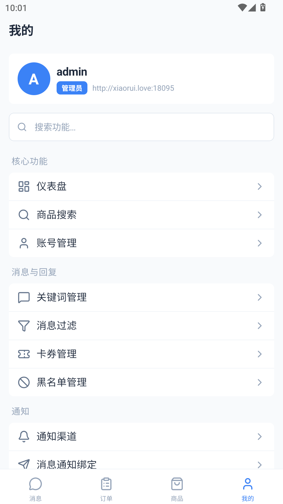

# 闲鱼自动回复系统

基于 FastAPI + React + MySQL + Redis + Playwright 的闲鱼多账号自动化系统。

主系统负责账号管理、消息收发、自动回复、自动发货、商品发布与后台管理；`promotion` 子项目负责返佣账号、选品规则、素材库、发布规则、删除规则和相关修复任务。

## 🔴 说明

> **🔴 诚邀各位开发者提交pr，完善系统**
>
> **🔴 承接各类项目定制，各类项目均可，有需要可联系，另外我菜，不一定都会**

## 🔴 最新源码地址(建议转存)

> 🔴 我用夸克网盘给你分享了「自动发货」，点击链接或复制整段内容，打开「夸克网盘APP」即可获取。
> 
> 🔴 /~79313YhCQU~:/
> 
> 🔴 **链接：https://pan.quark.cn/s/af567356cba7**

## 交流群

| 微信群 | QQ群 | 微信公众号 | Telegram | 赞赏支持 |
|:---:|:---:|:---:|:---:|:---:|
|  |  |  |  |  |
| 扫码加好友拉微信交流群 | 扫码加入QQ交流群 | 关注公众号发送"最新源码"获取最新代码 | 扫码加入Telegram群 | 如果觉得好用，请作者喝杯咖啡 |

如群二维码过期，请关注公众号获取最新群链接。

---

## 功能概览

### 主系统

| 模块 | 说明 |
|------|------|
| 多账号管理 | 支持多个闲鱼账号登录、状态切换、Cookie 维护与登录续期 |
| 自动回复 | 支持文本关键词、图片关键词、默认回复、商品专属回复 |
| AI 回复 | 支持大模型上下文对话与智能回复 |
| 自动发货 | 支持卡券、虚拟商品、自动补发、发送结果记录 |
| 在线聊天 | 支持会话列表、消息收发、聊天联动 |
| 商品发布 | 支持素材库、地址库、单品发布、批量发布、发布日志 |
| 订单与评价 | 订单拉取、自动评价、求小红花、状态跟踪 |
| 商品采集与分销 | Goofish 采集、货源管理、对接记录、结算链路 |
| 通知与风控 | 支持消息通知、风控日志、系统反馈与公告管理 |

### 返佣子系统

| 模块 | 说明 |
|------|------|
| 返佣账号 | 返佣账号登录、状态管理、Cookie 维护 |
| 选品规则 | 按规则抓取候选商品并自动写入素材库 |
| 素材库 | 管理标题、图片、详情、淘口令、短链、库存、发布状态 |
| 发布规则 | 定时发布返佣商品，复用公共发布能力 |
| 删除规则 | 定时删除已发布商品 |
| 补偿任务 | 已发布商品 ID 回写、短链修复、卡券补偿等 |

## 技术栈

### 后端与自动化

| 技术 | 说明 |
|------|------|
| FastAPI | 主系统与返佣后端 API 服务 |
| SQLAlchemy 2.0 | ORM 与数据库访问 |
| MySQL 8.0 | 主数据存储 |
| Redis 7 | 缓存、会话与任务辅助 |
| Playwright | 登录、Cookie 刷新、发布等浏览器自动化 |
| APScheduler | 定时任务调度 |
| Loguru | 日志管理 |

### 前端

| 技术 | 说明 |
|------|------|
| React 18 + TypeScript | 主系统与返佣前端 |
| Vite | 开发与构建 |
| TailwindCSS | 主系统 UI 样式 |
| Zustand | 状态管理 |
| Lucide React | 图标体系 |

### 部署

| 技术 | 说明 |
|------|------|
| Docker / Docker Compose | 容器化部署 |
| Nginx | 前端静态资源与反向代理 |

## 系统要求

### 开发环境

- Python 3.11+
- Node.js 18+
- MySQL 8.0+
- Redis 6+
- Chromium / Chrome（Playwright 相关功能）

### 生产环境

- Docker 20.10+
- Docker Compose 2.0+
- 最低 2 核 CPU / 4GB 内存
- 推荐 4 核 CPU / 8GB 内存

## 分支管理

本仓库的上游为 [zhinianboke/xianyu-auto-reply](https://github.com/zhinianboke/xianyu-auto-reply)。分支模型（`main` 稳定基线 / `dev` 日常开发 / `feature/*` 短期功能）与上游同步流程见 [BRANCHING.md](BRANCHING.md)。

### 独立版本与生产更新

本分支的产品版本唯一来源是 `common/version.py`，本次独立发布为 **1.1.4**。`UPSTREAM_VERSION` / `UPSTREAM_COMMIT` 记录已合入上游 **1.0.10** 的来源；合入上游时不直接采用其产品版本号。Web 与启动器共用本分支版本；Python 包、服务协议及前端 package.json 的版本不作为产品发布号。

`GET /api/v1/version/current` 返回 `version`、`upstream_version`、`upstream_commit`；`/version/check` 返回本分支发布说明，不请求上游更新服务器。桌面端不再下载安装上游发布包，避免覆盖本地定制。后续产品发布仅递增 `CURRENT_VERSION`，同步更新发布说明并重新构建部署。

已有 Docker 部署可使用 `docker/python/Dockerfile.release` 和 `docker/frontend/Dockerfile.release`：先核对并标记旧镜像，复用其已安装的 Python、依赖和 Chromium；Python 依赖通过 uv 补齐，前端在已有环境用 `pnpm --dir frontend build` 生成 `frontend/dist`。构建上下文 `release/tools/uv` 使用目标主机现有 Linux uv。镜像必须使用带产品版本及源码摘要的唯一标签，构建时保留旧服务，镜像验证后再切换四个应用容器。保留原 Compose 的网络、卷、端口和凭据，MySQL / Redis 无需更换。

数据库通过 `common/db/migrations/` 按编号升级，成功记录在 `xy_schema_migrations`；失败不记版本，修复后重复执行。迁移 001 收敛上游已有幂等升级逻辑，并检查实际表和字段。已有管理员改名不会重新生成默认管理员。部署前必须用旧库副本核对用户、账号、商品、设置与数量，复跑确认幂等，再验证副本备份可恢复；生产切换前停止应用写入并备份完整数据库、静态资源及浏览器数据。

回滚时停止四个应用容器，恢复部署前的 Compose、环境文件及旧镜像标签，再启动。若数据库变更影响旧版本，先恢复停写后的完整数据库备份；升级后新增业务数据须先另行导出，禁止直接覆盖。备份文件含凭据，只允许所有者读取。历史 `data/update_config.json` 不再参与本分支升级，恢复上游自动更新不属于回滚步骤。

## 项目结构

```text
xianyu-auto-reply/
├── backend-web/          # 主 Web API 服务（端口 8089）
├── websocket/            # 闲鱼连接与消息处理服务（端口 8090）
├── scheduler/            # 定时任务服务（端口 8091）
├── common/               # 主系统与返佣系统共享模块
├── frontend/             # 主系统前端（端口 9000）
├── launcher/             # Windows 桌面启动器（Nuitka 打包为 EXE）
├── promotion/
│   ├── backend/          # 返佣后端（端口 8092）
│   └── frontend/         # 返佣前端（端口 9001）
├── scripts/              # CI/CD 与工具脚本
├── docker/frontend/      # 前端 Dockerfile 与 Nginx 配置
├── docker-compose.yml    # 本地源码构建编排
├── deploy.sh             # 一键部署脚本（自动生成远程镜像版 compose）
├── deploy_remote.sh      # 远程 MySQL/Redis 一键部署脚本（自动生成 docker-compose.remote.yml）
├── update.sh             # 一键更新脚本（拉取最新远程镜像）
├── build.sh              # 本地源码全量构建脚本
├── build_frontend.sh     # 单独构建并重启 Frontend
├── build_backend_web.sh  # 单独构建并重启 Backend-Web
├── build_websocket.sh    # 单独构建并重启 WebSocket
├── build_scheduler.sh    # 单独构建并重启 Scheduler
├── EXE打包构建.bat       # Windows 桌面启动器打包脚本
├── 离线依赖打包.bat      # Windows 离线依赖打包脚本
└── README.md
```

### 服务职责

| 服务 | 默认端口 | 说明 |
|------|----------|------|
| `frontend` | 9000 | 主系统前端 |
| `backend-web` | 8089 | 主系统 API 网关、业务接口 |
| `websocket` | 8090 | 闲鱼 WebSocket、消息收发、登录与订单联动 |
| `scheduler` | 8091 | 定时任务执行器 |
| `promotion/backend` | 8092 | 返佣后端 API |
| `promotion/frontend` | 9001 | 返佣前端 |

### 架构说明

- 主系统采用多服务拆分：
  - `frontend` 负责界面与交互
  - `backend-web` 负责大部分业务 API
  - `websocket` 负责闲鱼实时连接、扫码登录、消息处理
  - `scheduler` 负责自动发货、评价、订单拉取、Cookie 刷新等定时任务
  - `common` 提供模型、数据库、自检、公共服务与工具
- 返佣子系统位于 `promotion/` 目录，前后端独立，当前不在根目录 Docker Compose 编排内
- 主系统三个后端服务都提供 `/health` 健康检查接口
- Docker 依赖链：mysql/redis → backend-web → websocket → scheduler；frontend → backend-web

## 快速开始

### 方式一：服务器一键部署（推荐）

服务器已安装 Docker 与 Docker Compose 后，直接执行一键部署脚本即可：

```bash
curl -fsSL https://xy-update.zhinianboke.com/deploy.sh | sed 's/\r$//' | bash
```

该脚本会自动完成部署所需的配置生成、镜像拉取、旧容器清理与服务启动。

更新版本，直接执行一键更新脚本即可：

```bash
curl -fsSL https://xy-update.zhinianboke.com/update.sh | sed 's/\r$//' | bash
```

### 方式二：克隆仓库部署

```bash
git clone https://github.com/zhinianboke/xianyu-auto-reply.git
cd xianyu-auto-reply
bash deploy.sh
```

- 首次运行会自动生成 `.env` 配置文件和 `docker-compose.deploy.yml`
- 从阿里云镜像仓库拉取预构建镜像并启动
- 如果检测到加密版容器会自动清理（保留数据卷）
- 部署完成后默认访问地址：
  - 前端：`http://服务器IP:9000`
  - API 文档：`http://服务器IP:8089/docs`
  - 默认账号：`admin` / `admin123`

后续更新：

```bash
bash update.sh
```

### 方式三：使用远程 MySQL / Redis 部署

当 MySQL 和 Redis 由外部（如云数据库 RDS、独立服务器或已有实例）提供时，可使用 `deploy_remote.sh`。
该脚本**不内置 mysql/redis 容器**，仅拉取并启动 4 个应用服务（frontend / backend-web / websocket / scheduler），
数据库连接信息通过 `.env.remote` 配置。与方式一相同，直接远程拉取脚本执行即可：

```bash
# 1) 首次运行：自动生成 .env.remote 后退出，提示填写远程连接信息
curl -fsSL https://xy-update.zhinianboke.com/deploy_remote.sh | sed 's/\r$//' | bash

# 2) 编辑 .env.remote，填写真实的远程地址（勿填 localhost）
#    MYSQL_HOST / REDIS_HOST 等
vim .env.remote

# 3) 再次运行：校验配置 → 自动生成 docker-compose.remote.yml → 拉取镜像 → 启动
curl -fsSL https://xy-update.zhinianboke.com/deploy_remote.sh | sed 's/\r$//' | bash
```

> 已克隆仓库的也可改用本地脚本：`bash deploy_remote.sh`（首次生成配置后退出，填好 `.env.remote` 再次执行）。

- 首次运行自动生成 `.env.remote`，每次运行自动生成 `docker-compose.remote.yml`，均不影响根目录原有的 `.env` / `docker-compose.yml` / `docker-compose.deploy.yml`
- 容器名与主套保持一致（`xianyu-backend-web` / `xianyu-websocket` / `xianyu-scheduler` / `xianyu-frontend`），与方式二/方式四属于同一套部署，二者只需选其一，不要同时启动
- 远程 MySQL 需提前创建好数据库（默认 `xianyu_data`）并授权部署机 IP 远程访问，应用启动时会自动建表与补齐字段
- 建议远程 MySQL 持久设置 `max_connect_errors=100000`；若出现错误码 1129，需在数据库服务器执行 `FLUSH HOSTS` 解除主机封锁
- 若远程库/缓存就在宿主机上，请使用 `host.docker.internal` 或宿主机内网 IP，**不要填 `localhost` / `127.0.0.1`**

### 方式四：本地源码 Docker 构建

```bash
bash build.sh rebuild
```

常用命令：

| 命令 | 说明 |
|------|------|
| `bash build.sh rebuild` | 删除旧容器与镜像，重新构建并启动 |
| `bash build.sh start` | 启动服务 |
| `bash build.sh stop` | 停止服务 |
| `bash build.sh restart` | 重启服务 |
| `bash build.sh logs` | 查看实时日志 |
| `bash build.sh status` | 查看服务状态 |

单独重建某个服务（不影响其他服务）：

```bash
bash build_frontend.sh      # 重建前端
bash build_backend_web.sh   # 重建 Backend-Web
bash build_websocket.sh     # 重建 WebSocket
bash build_scheduler.sh     # 重建 Scheduler
```

### 方式五：源码本地开发

#### 1. 准备基础服务

可以使用本机 MySQL / Redis，也可以仅用 Docker 启动基础设施：

```bash
docker compose up -d mysql redis
```

#### 2. 创建服务配置

主系统常用 `.env` 配置示例：

```env
ENVIRONMENT=development
MYSQL_HOST=127.0.0.1
MYSQL_PORT=3306
MYSQL_USER=root
MYSQL_PASSWORD=root
MYSQL_DATABASE=xianyu_data
REDIS_HOST=127.0.0.1
REDIS_PORT=6379
REDIS_PASSWORD=
REDIS_DB=0
CORS_ORIGINS=*
BACKEND_WEB_PORT=8089
WEBSOCKET_PORT=8090
SCHEDULER_PORT=8091
WEBSOCKET_SERVICE_URL=http://127.0.0.1:8090
SCHEDULER_SERVICE_URL=http://127.0.0.1:8091
BACKEND_WEB_SERVICE_URL=http://127.0.0.1:8089
STATIC_DIR=static
TZ=Asia/Shanghai
```

#### 3. 启动主系统后端

```bash
# Backend-Web 服务
cd backend-web
python -m venv .venv
# Windows: .venv\Scripts\activate
# Linux/macOS: source .venv/bin/activate
pip install -e .
python -m playwright install chromium
python -m patchright install chromium
python main.py
```

```bash
# WebSocket 服务
cd websocket
python -m venv .venv
# Windows: .venv\Scripts\activate
# Linux/macOS: source .venv/bin/activate
pip install -e .
python -m playwright install chromium
python -m patchright install chromium
python main.py
```

```bash
# Scheduler 服务
cd scheduler
python -m venv .venv
# Windows: .venv\Scripts\activate
# Linux/macOS: source .venv/bin/activate
pip install -e .
python -m playwright install chromium
python main.py
```

#### 4. 启动前端

```bash
cd frontend
pnpm install
pnpm run dev
```

#### 5. 使用命令行客户端

项目提供一个正式 CLI 包，直接调用 `backend-web` 已有 API，适合不想在页面里反复点击的批量查看和基础操作。

CLI 目录结构：

```text
xianyu_cli/
├── client.py            # HTTP 客户端与认证头处理
├── config.py            # 本地配置与 token 存储
├── output.py            # 表格/JSON 输出
├── openapi.py           # OpenAPI 路由发现、功能分组与 operationId 调用
├── frontend.py          # 前端 API 调用静态扫描与覆盖审计
├── websocket_client.py  # 在线聊天实时推送 WebSocket 监听
├── request_args.py      # JSON、表单、文件上传和下载参数解析
├── webmap.py            # 前端路由/页面到后端功能模块的映射
├── main.py              # xianyu-cli 入口
└── commands/            # 按功能拆分的命令模块
    ├── accounts.py      # 账号快捷命令
    ├── auth.py          # 登录、令牌刷新、token 和当前用户
    ├── items.py         # 商品快捷查询
    ├── publish.py       # 素材、发布能力、单品/批量上架和结果查询
    ├── orders.py        # 订单快捷查询
    ├── settings.py      # 系统设置快捷命令
    ├── web.py           # 按网页版页面浏览、覆盖检查和调用 API
    ├── features.py      # 按后端功能模块浏览和调用 API
    └── routes.py        # 按原始 OpenAPI operationId 调用 API
```

```bash
# 在项目根目录执行
uv run --no-project --python 3.12 scripts/xianyu_cli.py config set-url http://127.0.0.1:8089

# 检查后端地址、健康检查、OpenAPI 和 token 是否可用
uv run --no-project --python 3.12 scripts/xianyu_cli.py doctor

# 也可以离线读取本地 OpenAPI JSON 做接口审计
uv run --no-project --python 3.12 scripts/xianyu_cli.py --openapi-file ./openapi.json web coverage

# 登录后会把 token 保存到 ~/.xianyu-auto-reply-cli.json
uv run --no-project --python 3.12 scripts/xianyu_cli.py auth login -u admin

# 查看当前登录用户
uv run --no-project --python 3.12 scripts/xianyu_cli.py auth whoami

# 常用查询
uv run --no-project --python 3.12 scripts/xianyu_cli.py health
uv run --no-project --python 3.12 scripts/xianyu_cli.py accounts list --page-size 50
uv run --no-project --python 3.12 scripts/xianyu_cli.py items list --account-id <账号ID>
uv run --no-project --python 3.12 scripts/xianyu_cli.py orders --search <订单号或商品ID>
uv run --no-project --python 3.12 scripts/xianyu_cli.py keywords --account-id <账号ID>

# 常用操作
uv run --no-project --python 3.12 scripts/xianyu_cli.py accounts disable <账号ID>
uv run --no-project --python 3.12 scripts/xianyu_cli.py accounts enable <账号ID>
uv run --no-project --python 3.12 scripts/xianyu_cli.py accounts remark <账号ID> "备用账号"

# Cookie 较长时建议从 stdin 输入
pbpaste | uv run --no-project --python 3.12 scripts/xianyu_cli.py accounts cookie <账号ID>

# 兜底：直接调用任意 backend-web API
uv run --no-project --python 3.12 scripts/xianyu_cli.py api GET /api/v1/system-settings
uv run --no-project --python 3.12 scripts/xianyu_cli.py api PUT /api/v1/system-settings/registration_enabled -d '{"value":"false"}'

# 文件上传、导入和导出也走同一套调用能力
uv run --no-project --python 3.12 scripts/xianyu_cli.py api POST /api/v1/upload/upload-image -F image=./card.png
uv run --no-project --python 3.12 scripts/xianyu_cli.py api POST /api/v1/cookies/import -F file=./accounts.xlsx -f enable_all=true
uv run --no-project --python 3.12 scripts/xianyu_cli.py api POST /api/v1/cookies/export -d '{}' -o ./accounts_export.xlsx
```

完整的上架、发货配置、卡券库存、订单与自动发货日志流程见 [CLI经营操作手册](docs/cli-operations.md)。新增命令仅调用已有后端接口；没有在 CLI 中另建发货定时器、任务队列或重复提交策略。1.1.2 同时修复单个/批量新建卡券时 `enabled=false` 被覆盖的问题。

`features` 和 `routes` 命令会读取后端 `/openapi.json`。`features` 按网页版功能模块分组，适合日常使用；`routes` 保留原始 OpenAPI 视角，适合精确排查。

#### CLI 自动化发布

CLI 本身仅依赖 Python 标准库，可以通过 `uv run --no-project --python 3.12 scripts/xianyu_cli.py` 复用已有 Python 3.12，无需安装整个后端。以下 shell 函数用于缩短命令，须在仓库根目录执行：

```bash
xianyu-cli() { uv run --no-project --python 3.12 scripts/xianyu_cli.py "$@"; }

xianyu-cli config set-url https://your-domain.example
xianyu-cli auth login -u automation
xianyu-cli auth whoami
# refresh token 仍有效时可更新登录态；已失效则需要重新登录。
xianyu-cli auth refresh
xianyu-cli accounts list
```

后台用户登录和闲鱼账号登录是两个步骤。后台用户登录后，可以通过 `accounts create` / `accounts cookie` 导入合法 Cookie，或通过 `api POST /api/v1/qr-login/generate` 发起闲鱼扫码登录，再用 `api GET /api/v1/qr-login/status/<session_id>` 查询结果。扫码确认或平台要求的手机验证仍由账号持有人完成，后续接口会自动保存账号状态。

发布流程复用后端的一个规范请求结构，不在 CLI 中复制商品校验、分类推荐或发布实现：

```bash
# 上传本机图片；使用响应中的 data.paths 作为素材 JSON 的 images 字段。
xianyu-cli api POST /api/v1/product-publish/upload/images -F files=./product.jpg
# material.json 使用后端 MaterialCreateRequest 字段。
xianyu-cli publish materials create --data-file ./material.json
xianyu-cli publish materials list --page-size 20

# 新版后端可查询账号 Cookie、鱼小铺状态和发布能力。
xianyu-cli publish check-account <账号ID>
# single.json 使用后端 PublishSingleRequest 字段，包括 account_id。
xianyu-cli publish single --data-file ./single.json

# 对每个指定账号发布每份指定素材；不会自动重试或重复提交。
xianyu-cli publish batch --account-id <账号ID> --material-id <素材ID>
# 批量提交返回 batch_id，只代表任务已提交。
xianyu-cli --json publish status <batch_id>
```

批量命令支持重复传入 `--account-id` 和 `--material-id`。验收时须检查任务中的成功/失败数量、发布日志和实际商品 ID/链接；HTTP 200 或取得 `batch_id` 不代表已经上架成功。`publish` 请求被后端拒绝、`auth refresh` 失败或 `auth whoami` 未认证时，CLI 返回非零退出码。

通用 `api`、`features call`、`routes call` 和 `web call` 同样支持 `--data-file`；它与 `--data` 互斥。密码、Cookie、令牌文件应只允许所有者读取，不应提交到仓库，普通输出和 `--json` 均对 Cookie、令牌、API请求头和发货内容脱敏；需要完整备份时使用通用 `api -o` 保存为仅所有者可读的文件，不把内容贴进日志。

使用前端域名调用 CLI 时，Nginx 必须将 `/openapi.json` 代理至 backend-web，不能返回 SPA 页面。本仓库配置已补齐该路径；既有部署需更新前端容器后才生效。该代理仅提供接口规范，受保护接口仍需正常鉴权。需要回滚时恢复原前端镜像及 CLI 文件即可，不涉及数据库迁移。

`web ops`、`features ops` 和 `routes list` 输出里的 `inputs` 字段用于提示调用参数：
`path:name*` 对应 `-p name=...`，`query:name` 对应 `-q name=...`，`body:json*` 对应 `-d '{...}'`，`body:multipart*` 对应 `-f key=value` / `-F file=...`；`*` 表示 OpenAPI 标记为必填。

如果不想手写参数，可以先生成完整调用模板。默认只生成必填参数；加 `--include-optional` 会把 OpenAPI 里的可选字段也放进模板：

```bash
python scripts/xianyu_cli.py web examples accounts --search import
python scripts/xianyu_cli.py features examples cookies --search status
python scripts/xianyu_cli.py routes template list_cookie_details_paginated_api_v1_cookies_details_paginated_get
```

`web` 命令按前端页面组织接口，更接近网页版菜单：

```bash
# 列出网页版页面与对应 API 功能模块
python scripts/xianyu_cli.py web pages

# 检查网页版页面是否都有后端 OpenAPI 映射
python scripts/xianyu_cli.py web coverage
python scripts/xianyu_cli.py web coverage --only missing
python scripts/xianyu_cli.py web coverage --unmapped-features
python scripts/xianyu_cli.py --openapi-file ./openapi.json web coverage --only missing

# 审计前端源码实际调用的 API 是否都存在于 OpenAPI，并且都能映射到页面 feature
python scripts/xianyu_cli.py web audit
python scripts/xianyu_cli.py web audit --only missing_openapi
python scripts/xianyu_cli.py web audit --only unmapped_feature
python scripts/xianyu_cli.py --openapi-file ./openapi.json web audit --frontend-root frontend/src

# 按 frontend/src/api 里的导出函数查 CLI 调用模板，更贴近网页版源码
python scripts/xianyu_cli.py web functions --search getAccountDetails
python scripts/xianyu_cli.py web functions --search accounts --include-optional
python scripts/xianyu_cli.py --openapi-file ./openapi.json web functions --frontend-root frontend/src
# 精确查看某个前端函数；组合式函数会展开成多条后端接口模板
python scripts/xianyu_cli.py web function addKeyword
# 一对一函数可直接用 web function-call

# 聚合门禁：同时检查页面映射、后端 feature 映射、前端源码 API；默认有问题就返回非 0
python scripts/xianyu_cli.py web verify
python scripts/xianyu_cli.py web verify accounts
python scripts/xianyu_cli.py web verify --skip-frontend
python scripts/xianyu_cli.py web verify --allow-failures

# 运行只读 smoke 测试：只会自动挑选无必填参数的 GET JSON 接口；默认有失败就返回非 0
python scripts/xianyu_cli.py web smoke --dry-run
python scripts/xianyu_cli.py web smoke accounts --dry-run
python scripts/xianyu_cli.py web smoke accounts --limit 10 --fail-fast
python scripts/xianyu_cli.py web smoke accounts --allow-failures
python scripts/xianyu_cli.py web smoke login --no-auth --limit 5

# 查看某个页面能调用哪些 API，页面可用 key、路径或中文标题
python scripts/xianyu_cli.py web ops accounts
python scripts/xianyu_cli.py web ops /accounts
python scripts/xianyu_cli.py web ops 账号管理

# 生成页面下某些操作的可复制 CLI 调用模板
python scripts/xianyu_cli.py web examples accounts --search import

# 按页面调用接口，操作名来自 web ops 的 feature.operation，也可用页面内唯一操作名或 operationId
python scripts/xianyu_cli.py web call accounts cookies.get-details-paginated -q page=1 -q page_size=50
python scripts/xianyu_cli.py web call 账号管理 cookies.get-details-paginated -q page=1 -q page_size=50

# 也可以直接按前端 API 函数名调用；重名时用 module.function
python scripts/xianyu_cli.py web function-call accounts.getAccountDetails
python scripts/xianyu_cli.py web function-call getAccountDetails

# 监听在线聊天实时推送。WebSocket 不在 OpenAPI 里，CLI 单独提供 web ws
python scripts/xianyu_cli.py web ws <账号ID>
python scripts/xianyu_cli.py web ws <账号ID> --limit 10 --timeout 60

# 页面维度调用同样支持文件上传/下载
python scripts/xianyu_cli.py web call accounts cookies.post-import -F file=./accounts.xlsx -f enable_all=true
python scripts/xianyu_cli.py web call accounts cookies.post-export -d '{}' -o ./accounts_export.xlsx
```

```bash
# 按功能模块列出接口，例如 cookies、items、orders、chat-new、product-publish
python scripts/xianyu_cli.py features list

# 查看某个功能模块有哪些操作
python scripts/xianyu_cli.py features ops cookies

# 生成模块下某些操作的可复制 CLI 调用模板
python scripts/xianyu_cli.py features examples cookies --search export

# 按功能模块调用，操作名来自 features ops
python scripts/xianyu_cli.py features call cookies get-details-paginated -q page=1 -q page_size=50
python scripts/xianyu_cli.py features call cookies put-account-id-status -p account_id=<账号ID> -d '{"enabled":false}'
```

`routes` 可发现和调用网页版使用的全部后端接口：

```bash
# 列出全部接口
python scripts/xianyu_cli.py routes list

# 搜索账号相关接口
python scripts/xianyu_cli.py routes list --search cookies

# 查看某个 operationId 的完整定义
python scripts/xianyu_cli.py routes show list_cookie_details_paginated_api_v1_cookies_details_paginated_get

# 生成单个 operationId 的可复制 CLI 调用模板
python scripts/xianyu_cli.py routes template list_cookie_details_paginated_api_v1_cookies_details_paginated_get

# 按 operationId 调用接口，-p 传路径参数，-q 传查询参数，-d 传 JSON 请求体
python scripts/xianyu_cli.py routes call list_cookie_details_paginated_api_v1_cookies_details_paginated_get -q page=1 -q page_size=50
```

安装为可执行命令后也可以直接使用：

```bash
pip install -e .
xianyu-cli accounts list
```

如果后端开启了登录滑动验证码，CLI 的用户名密码登录会被后端拦截。可先在页面完成登录后复制 access token，再写入 CLI：

```bash
python scripts/xianyu_cli.py auth token set <access-token>
```

#### 6. 启动返佣子系统

```bash
# 返佣后端
cd promotion/backend
pip install -e .
python main.py

# 返佣前端
cd promotion/frontend
pnpm install
pnpm run dev
```

## 配置说明

### 关键环境变量

| 变量 | 说明 |
|------|------|
| `MYSQL_HOST` / `MYSQL_PORT` / `MYSQL_USER` / `MYSQL_PASSWORD` / `MYSQL_DATABASE` | MySQL 连接 |
| `REDIS_HOST` / `REDIS_PORT` / `REDIS_PASSWORD` / `REDIS_DB` | Redis 连接 |
| `JWT_SECRET_KEY` | JWT 密钥，由数据库统一托管（首次启动自动生成并持久化），无需手动配置 |
| `INTERNAL_API_TOKEN` | 服务间共享令牌，保护 `/internal` 与 `/password-login`；源码启动可留空，由 backend-web 首次启动持久化到数据库；Compose 部署由脚本生成并要求非空 |
| `BACKEND_WEB_PORT` / `WEBSOCKET_PORT` / `SCHEDULER_PORT` | 各服务端口 |
| `WEBSOCKET_SERVICE_URL` / `SCHEDULER_SERVICE_URL` / `BACKEND_WEB_SERVICE_URL` | 服务间调用地址 |
| `BACKEND_WEB_PUBLIC_URL` | 对外访问地址，用于生成文件 URL |
| `CORS_ORIGINS` | CORS 白名单 |
| `BROWSER_HEADLESS` | Playwright 是否无头运行 |

### 服务间令牌与上游升级

- `backend-web` 启动时初始化 `security.internal_api_token`；`websocket` 和 `scheduler` 只读取，启动顺序保持 backend-web → websocket → scheduler。
- 已有部署脚本生成的 24 位随机令牌保持有效；数据库已有令牌优先，不在更新时轮换。令牌缺失时拒绝内部请求，错误令牌返回 401。
- JWT 与内部令牌不通过通用设置 API 返回或修改；SMTP、支付与远程滑块密钥继续脱敏显示，原样保存 `***` 不覆盖原值。
- 同步上游时保留移除广告、CLI 与安全修复；Android 客户端也不包含广告管理入口。合并回归测试使用 `uv run --extra dev pytest -q tests`，数据库测试仅操作临时 SQLite，不连接实际 MySQL。
- 升级前备份 MySQL 与当前 `.env`，源码启动先运行 backend-web 完成已有的数据库自检。回滚需恢复升级前的数据库备份和源码版本，再沿用原 `.env`；仅回退源码不代表已回退新增字段与数据。

### 数据库与初始化

- 主系统启动时自动建表、自检、缺失字段补齐、默认数据初始化
- 默认管理员：`admin` / `admin123`
- 返佣系统启动时执行独立的数据库自检
- 返佣系统表统一使用 `fy_` 前缀
- 不依赖外键约束，关系由代码维护
- 所有时间统一使用北京时间（`Asia/Shanghai`）

### 统一响应格式

后端采用统一响应包装，业务异常也返回 HTTP 200：

```json
{
  "success": true,
  "code": 200,
  "message": "操作成功",
  "data": {}
}
```

## 构建脚本速查

| 脚本 | 平台 | 作用 |
|------|------|------|
| `deploy.sh` | Linux | 生成远程镜像版 compose 并拉取镜像启动（首次部署） |
| `deploy_remote.sh` | Linux | 使用远程 MySQL/Redis 部署，生成 `docker-compose.remote.yml` 与 `.env.remote` 并启动应用服务 |
| `update.sh` | Linux | 拉取最新远程镜像并重建应用容器（后续更新） |
| `build.sh` | Linux | 从源码全量构建所有 Docker 镜像并启动 |
| `build_frontend.sh` | Linux | 单独重建并重启 Frontend 服务 |
| `build_backend_web.sh` | Linux | 单独重建并重启 Backend-Web 服务 |
| `build_websocket.sh` | Linux | 单独重建并重启 WebSocket 服务 |
| `build_scheduler.sh` | Linux | 单独重建并重启 Scheduler 服务 |
| `EXE打包构建.bat` | Windows | 使用 Nuitka 打包桌面启动器 EXE |
| `离线依赖打包.bat` | Windows | 打包所有 Python 依赖供离线安装 |
| `scripts/Pipeline脚本-xianyu-auto-reply.groovy` | Jenkins | CI/CD 流水线，构建多架构镜像并推送到阿里云 ACR |

## 安全说明

- **JWT 认证**：主系统与返佣系统都使用 JWT 做登录态控制
- **密码存储**：密码使用哈希方式保存
- **SQL 注入防护**：数据库访问使用参数化查询
- **XSS 防护**：前端输入与展示做好校验与转义
- **CORS 控制**：生产环境应限制到明确域名

### 生产环境建议

1. 立即修改默认管理员密码
2. JWT 密钥由数据库统一托管，首次启动自动生成强随机密钥（无需手动设置）
3. 设置正确的 `BACKEND_WEB_PUBLIC_URL` 与反向代理地址
4. 为外网入口配置 HTTPS
5. 定期备份 MySQL 与静态资源目录
6. 确保 Playwright 浏览器已正确安装

## 常见问题

### 根目录 Docker Compose 没有启动返佣系统？

当前 `docker-compose.yml` 只覆盖主系统。返佣系统需要单独启动。

### 登录或发布时报浏览器缺失？

Backend-Web 和 WebSocket 需要在对应 Python 环境依次执行：
`python -m playwright install chromium`、`python -m patchright install chromium`。
Docker 环境依赖各服务 Dockerfile 内已安装的浏览器。

### Docker 部署端口冲突？

修改根目录 `.env` 中的端口配置后重新部署。

### 执行脚本报 `/bin/bash^M: 坏的解释器`？

脚本文件包含 Windows 换行符（CRLF），Linux 无法识别。解决方法：

```bash
# 方法一：用 sed 去除 \r 后执行
sed -i 's/\r$//' deploy.sh
bash deploy.sh

# 方法二：通过管道执行（推荐远程脚本使用）
curl -fsSL https://xy-update.zhinianboke.com/deploy.sh | sed 's/\r$//' | bash
```

## 许可证

本项目采用 [GNU Affero General Public License v3.0 (AGPL-3.0)](LICENSE) 开源协议。

**⚠️ 禁止商业用途：本项目仅供学习研究使用，严禁任何形式的商业用途。**

## 免责声明

本项目仅供技术学习和研究使用，使用者需自行承担使用风险。请遵守相关平台的使用条款和法律法规。

- 本项目不对使用本系统造成的任何后果负责
- 请勿用于违反闲鱼平台规则的行为
- 请勿用于商业用途
- 使用本系统可能存在账号风险，请谨慎使用

## 🧸 特别鸣谢

本项目参考了以下开源项目：

- **[XianYuApis](https://github.com/cv-cat/XianYuApis)** - 提供了闲鱼API接口的技术参考
- **[XianyuAutoAgent](https://github.com/shaxiu/XianyuAutoAgent)** - 提供了自动化处理的实现思路
- **[myfish](https://github.com/Kaguya233qwq/myfish)** - 提供了扫码登录的实现思路


感谢这些优秀的开源项目为本项目的开发提供了宝贵的参考和启发！


## 公开账号查询接口

所有公开接口的完整 URL 格式均为：
`http(s)://<服务域名或IP>:<端口>/api/v1/...`。无需登录，使用个人设置「分销管理」中的
`secret_key` 校验。

### POST `/api/v1/external/enabled-accounts`

获取秘钥所属用户的全部闲鱼账号（包含已禁用账号）。

请求头：`Content-Type: application/json`

请求体：

| 参数 | 类型 | 必填 | 说明 |
| --- | --- | --- | --- |
| `secret_key` | string | 是 | 分销秘钥，最长 128 个字符 |

```json
{
  "secret_key": "your-secret-key"
}
```

成功返回：

```json
{
  "success": true,
  "code": 200,
  "message": "查询成功",
  "data": {
    "accounts": [
      {
        "account_id": "闲鱼账号ID",
        "remark": "账号备注",
        "enabled": true,
        "status": "active",
        "status_name": "启用",
        "disable_reason": ""
      }
    ],
    "total": 1,
    "enabled_total": 1,
    "disabled_total": 0
  }
}
```

`enabled` 表示账号当前是否可用；`status` 保留账号原始状态，`status_name` 为中文状态名称。

### 外部账号 Cookie 同步

供外部系统回传账号最新 Cookie。该接口只更新 Cookie，不重启账号 WebSocket 任务。

#### POST `/api/v1/external/account-cookie/sync`

请求头：`Content-Type: application/json`

请求体：

| 参数 | 类型 | 必填 | 限制/说明 |
| --- | --- | --- | --- |
| `secret_key` | string | 是 | 分销秘钥，最长 128 个字符，必须属于目标账号所属用户 |
| `account_id` | string | 是 | 闲鱼账号 ID，最长 80 个字符 |
| `cookies` | string | 是 | 最新 Cookie 字符串，最长 16384 个字符，必须包含登录态 `unb` |

```json
{
  "secret_key": "your-secret-key",
  "account_id": "闲鱼账号ID",
  "cookies": "unb=...; _m_h5_tk=...; ..."
}
```

成功返回：

```json
{
  "success": true,
  "code": 200,
  "message": "Cookie 已更新",
  "data": null
}
```

失败时同样固定返回 HTTP `200`，并通过 `success=false`、`code` 和中文 `message`
表达业务错误。常见错误码为：`40001`（秘钥无效/用户不可用）、`40002`（账号不存在或秘钥与账号不匹配）、
`40007`（Cookie 格式或归属校验失败）、`40008`（请求参数不完整）、
`50001`（账号、秘钥或 Cookie 更新失败）。

## 公开商品发布相关接口

建议按以下顺序调用：

1. 调用公开账号查询接口获取 `account_id`。
2. 调用分类推荐接口获取 `category` 和完整 `card_list`。
3. 如需填写平台动态属性，调用分类属性接口。
4. 调用媒体上传接口上传图片/视频，取得 `media_id`。
5. 调用单品发布接口。

### 1. 分类推荐

#### POST `/api/v1/external/category/recommend`

请求头：`Content-Type: application/json`

请求体：

| 参数 | 类型 | 必填 | 限制/说明 |
| --- | --- | --- | --- |
| `secret_key` | string | 是 | 分销秘钥，最长 128 个字符 |
| `account_id` | string | 是 | 闲鱼账号 ID，最长 80 个字符，必须属于该秘钥用户 |
| `description` | string | 是 | 商品描述，最长 1500 个字符 |

```json
{
  "secret_key": "your-secret-key",
  "account_id": "闲鱼账号ID",
  "description": "全新未拆封的商品，支持官方验货，配件齐全"
}
```

成功返回：

```json
{
  "success": true,
  "code": 200,
  "message": "分类推荐成功",
  "data": {
    "candidates": [
      {
        "cat_id": "平台末级分类ID",
        "cat_name": "分类名称",
        "channel_cat_id": "频道分类ID",
        "channel_cat_name": "频道分类名称",
        "leaf_id": "叶子分类ID",
        "tb_cat_id": "淘宝分类ID",
        "path": [
          {"id": "100", "name": "一级分类"},
          {"id": "10001", "name": "末级分类"}
        ],
        "score": 0.98,
        "is_selected": false
      }
    ],
    "properties": [
      {
        "property_id": "属性ID",
        "property_name": "品牌",
        "input_word": null,
        "is_multiple": false,
        "is_decisive_property": false,
        "options": [
          {
            "property_id": "属性ID",
            "property_name": "品牌",
            "value_id": "属性值ID",
            "value_name": "品牌名称",
            "channel_cat_id": "频道分类ID",
            "tb_cat_id": "淘宝分类ID"
          }
        ]
      }
    ],
    "card_list": [],
    "account_id": "闲鱼账号ID"
  }
}
```

`card_list` 是平台返回的完整属性卡片数组。调用分类属性接口时必须原样传回该数组；
`candidates` 中的分类对象可直接作为后续接口的 `category`。

### 2. 获取分类动态属性

#### POST `/api/v1/external/category/properties`

请求头：`Content-Type: application/json`

请求体：

| 参数 | 类型 | 必填 | 限制/说明 |
| --- | --- | --- | --- |
| `secret_key` | string | 是 | 分销秘钥，最长 128 个字符 |
| `account_id` | string | 是 | 闲鱼账号 ID，最长 80 个字符 |
| `description` | string | 是 | 商品描述，最长 1500 个字符 |
| `category` | object | 是 | 分类推荐接口 `data.candidates` 中选中的分类对象；至少提供 `cat_id`、`cat_name`、`channel_cat_id`、`tb_cat_id` 之一 |
| `card_list` | object[] | 是 | 分类推荐接口返回的完整 `data.card_list`，最多 100 条 |

```json
{
  "secret_key": "your-secret-key",
  "account_id": "闲鱼账号ID",
  "description": "全新未拆封的商品，支持官方验货，配件齐全",
  "category": {
    "channel_cat_id": "频道分类ID",
    "channel_cat_name": "频道分类名称",
    "cat_name": "末级分类名称",
    "tb_cat_id": "淘宝分类ID"
  },
  "card_list": []
}
```

成功返回结构与分类推荐接口相同：`data.candidates`、`data.properties`、
`data.card_list`、`data.account_id`；成功消息为「分类属性获取成功」。

### 3. 上传发布媒体

#### POST `/api/v1/external/publish/media`

请求类型：`multipart/form-data`。

| 表单参数 | 类型 | 必填 | 限制/说明 |
| --- | --- | --- | --- |
| `secret_key` | string | 是 | 分销秘钥，最长 128 个字符 |
| `account_id` | string | 是 | 闲鱼账号 ID，最长 80 个字符 |
| `media_type` | string | 是 | `image` 商品图片、`spec_image` 规格图片或 `video` 商品视频 |
| `file` | file | 是 | 要上传的媒体文件 |

```bash
curl -X POST "http(s)://<服务域名或IP>:<端口>/api/v1/external/publish/media" \
  -F "secret_key=your-secret-key" \
  -F "account_id=闲鱼账号ID" \
  -F "media_type=image" \
  -F "file=@/path/to/image.jpg"
```

成功返回：

```json
{
  "success": true,
  "code": 200,
  "message": "媒体上传成功",
  "data": {
    "media_id": "image_0123456789abcdef0123456789abcdef",
    "media_type": "image",
    "name": "image_0123456789abcdef0123456789abcdef.jpg",
    "size": 123456
  }
}
```

`media_id` 只能在生成它的同一个 `account_id` 下的单品发布请求中使用，不能跨账号使用，
也不能把本地文件路径直接传给单品发布接口。

### 4. 发布单个商品

#### POST `/api/v1/external/publish/single`

请求头：`Content-Type: application/json`

请求体：

| 参数 | 类型 | 必填 | 默认值 | 限制/说明 |
| --- | --- | --- | --- | --- |
| `secret_key` | string | 是 | - | 分销秘钥，最长 128 个字符 |
| `account_id` | string | 是 | - | 闲鱼账号 ID，最长 80 个字符 |
| `title` | string | 是 | - | 商品标题，最长 200 个字符 |
| `description` | string | 是 | - | 商品描述，最长 1500 个字符 |
| `price` | number | 是 | - | 商品售价，必须大于 0 |
| `original_price` | number | 否 | - | 原价，必须大于 0 |
| `image_media_ids` | string[] | 是 | - | 图片媒体 ID，至少 1 个、最多 9 个，必须为 `image` 类型 |
| `video_media_ids` | string[] | 否 | `[]` | 最多 3 个，必须为 `video` 类型 |
| `platform_category_id` | string | 否 | - | 平台末级分类 ID |
| `platform_category_name` | string | 否 | - | 平台分类名称 |
| `platform_channel_category_id` | string | 否 | - | 频道分类 ID |
| `platform_channel_category_name` | string | 否 | - | 频道分类名称 |
| `platform_leaf_id` | string | 否 | - | 叶子分类 ID |
| `platform_tb_category_id` | string | 否 | - | 淘宝分类 ID |
| `platform_attributes` | object[] | 否 | `[]` | 平台属性，最多 30 条 |
| `quantity` | integer | 否 | `1` | 库存数量，1～999999 |
| `specifications` | object[] | 否 | `[]` | 最多 2 个规格维度 |
| `sku_rows` | object[] | 否 | `[]` | 最多 200 条 SKU |
| `address` | string | 是 | - | 宝贝所在地，最长 200 个字符；需传外部系统已选择的地址关键词 |
| `address_expected_text` | string | 否 | - | 地址预期展示文本，最长 200 个字符 |
| `delivery_method` | string | 否 | `express` | `express` 快递或 `pickup` 自提 |
| `shipping_method` | string | 否 | `free` | `free` 包邮、`distance` 按距离计费、`fixed` 一口价、`template` 运费模板、`none` 无需邮寄 |
| `postage` | number | 否 | `0` | `shipping_method=fixed` 时的运费，0～1000 元 |
| `support_pickup` | boolean | 否 | `false` | 是否支持自提；与 `shipping_method` 独立 |

`platform_attributes` 每项可传：`property_id`（最长 64）、`property_name`（最长 100）、
`value_id`（最长 64）、`value_name`（最长 200）、`text`（最长 200）、
`properties`（最长 500）。

`specifications` 每项包含 `name`（必填，最长 100）、`support_image`（默认 `false`）和
`values`（最多 50 项）；`values` 每项包含 `name`（必填，最长 100）及可选的
`image_media_id`（必须是同账号的 `spec_image` 媒体 ID）。

`sku_rows` 每项包含 `specs`（规格名到规格值的对象，最多 4 个键）、`price`（大于 0）、
`stock`（0～999999）。

请求示例：

```json
{
  "secret_key": "your-secret-key",
  "account_id": "闲鱼账号ID",
  "title": "全新商品标题",
  "description": "商品详细描述",
  "price": 99.9,
  "original_price": 129.9,
  "image_media_ids": ["image_0123456789abcdef0123456789abcdef"],
  "video_media_ids": [],
  "platform_category_id": "平台分类ID",
  "platform_category_name": "平台分类名称",
  "platform_channel_category_id": "频道分类ID",
  "platform_channel_category_name": "频道分类名称",
  "platform_leaf_id": "叶子分类ID",
  "platform_tb_category_id": "淘宝分类ID",
  "platform_attributes": [],
  "quantity": 1,
  "specifications": [],
  "sku_rows": [],
  "address": "上海市",
  "address_expected_text": "上海",
  "delivery_method": "express",
  "shipping_method": "free",
  "postage": 0,
  "support_pickup": false
}
```

成功返回：

```json
{
  "success": true,
  "code": 200,
  "message": "商品发布成功",
  "data": {
    "item_url": "商品详情链接",
    "item_id": "平台商品ID",
    "log_id": 123,
    "sync_status": "success",
    "sync_message": "已自动获取商品并入库 1 个商品",
    "sync_total_count": 1,
    "sync_saved_count": 1
  }
}
```

发布失败时仍返回 HTTP `200`，`success=false`、`code=40009`；媒体不存在、类型不匹配或
媒体不属于目标账号时返回 `40007`。

### 商品发布相关接口常见错误码

| `code` | 含义 |
| --- | --- |
| `40001` | 分销秘钥为空、超长或不存在 |
| `40002` | 闲鱼账号 ID 为空、超长、不存在或不属于该秘钥用户 |
| `40004` | 商品描述为空或超长（分类接口） |
| `40005` | 分类推荐/动态属性获取失败 |
| `40006` | 分类选择数据缺失、`category`/`card_list` 格式错误 |
| `40007` | 媒体参数或媒体文件错误 |
| `40008` | 发布请求参数格式错误或必填字段为空 |
| `40009` | 商品发布执行失败 |
| `50001` | 服务端查询或处理失败，请稍后重试 |

## 公开订单查询接口

接口地址：`/api/v1/external/orders`，完整 URL 格式为
`http(s)://<服务域名或IP>:<端口>/api/v1/external/orders`。无需登录，使用用户分销秘钥校验，只返回该秘钥所属用户的订单。

### 1. POST JSON 调用

```http
POST /api/v1/external/orders
Content-Type: application/json
```

请求体：

| 参数 | 类型 | 必填 | 默认值 | 说明 |
| --- | --- | --- | --- | --- |
| `secret_key` | string | 是 | - | 个人设置-分销管理中的分销秘钥，最长 128 个字符 |
| `item_ids` | string[] | 否 | `[]` | 商品 ID 数组，最多 100 个；不传表示查询该秘钥所属用户的全部订单 |
| `item_id` | string | 否 | - | 单个或多个商品 ID，多个 ID 用英文逗号分隔；也可与 `item_ids` 同时传 |
| `order_no` | string | 否 | - | 订单号，精确查询，最长 64 个字符 |
| `page` | integer | 否 | `1` | 页码，从 1 开始 |
| `page_size` | integer | 否 | `20` | 每页数量，取值 1～100 |

示例：

```json
{
  "secret_key": "your-secret-key",
  "item_ids": ["商品ID1", "商品ID2"],
  "order_no": "订单号（可选）",
  "page": 1,
  "page_size": 20
}
```

### 2. GET 查询参数调用

```http
GET /api/v1/external/orders?secret_key=your-secret-key&page=1&page_size=20
```

GET 参数与 POST 参数含义相同。商品 ID 支持以下两种传法：

```http
# 重复传 item_id
GET /api/v1/external/orders?secret_key=your-secret-key&item_id=商品ID1&item_id=商品ID2&page=1&page_size=20

# item_ids 使用逗号分隔
GET /api/v1/external/orders?secret_key=your-secret-key&item_ids=商品ID1,商品ID2&page=1&page_size=20
```

`order_no` 可以单独传，也可以和商品 ID、分页参数一起传；多个筛选条件同时传入时按“同时满足”查询。

### 3. 成功返回

HTTP 状态码固定为 `200`，业务结果通过响应体判断：

```json
{
  "success": true,
  "code": 200,
  "message": "订单查询成功",
  "data": {
    "list": [
      {
        "id": "订单数据库ID",
        "order_no": "订单号",
        "order_id": "订单号（与 order_no 相同）",
        "item_id": "商品ID",
        "item_title": "商品标题",
        "status": "订单状态（小写）",
        "buyer_id": "买家ID",
        "buyer_nick": "买家昵称",
        "buyer_fish_nick": "买家闲鱼昵称",
        "chat_id": "聊天会话ID",
        "spec_name": "规格名称",
        "spec_value": "规格值",
        "sku_info": "规格名称 / 规格值",
        "quantity": 1,
        "amount": "99.00",
        "currency": "CNY",
        "account_id": "闲鱼账号ID",
        "cookie_id": "闲鱼账号ID（与 account_id 相同）",
        "account_name": "闲鱼账号名称",
        "is_bargain": false,
        "is_rated": false,
        "is_red_flower": false,
        "is_unregistered": false,
        "unregister_error_reason": "",
        "receiver_name": "收货人",
        "receiver_phone": "收货电话",
        "receiver_address": "收货地址",
        "delivery_method": "auto",
        "delivery_content": "发货内容",
        "delivery_fail_reason": "",
        "card_only_delivered": false,
        "delivery_send_status": "success",
        "delivery_send_fail_reason": null,
        "source": "数据来源",
        "placed_at": "2026-01-01T12:00:00+08:00",
        "synced_at": "2026-01-01T12:01:00+08:00",
        "created_at": "2026-01-01T12:01:00+08:00",
        "updated_at": "2026-01-01T12:01:00+08:00"
      }
    ],
    "orders": [
      {
        "id": "订单数据库ID",
        "order_no": "订单号",
        "order_id": "订单号（与 order_no 相同）",
        "item_id": "商品ID",
        "item_title": "商品标题",
        "status": "订单状态（小写）",
        "buyer_id": "买家ID",
        "buyer_nick": "买家昵称",
        "buyer_fish_nick": "买家闲鱼昵称",
        "chat_id": "聊天会话ID",
        "spec_name": "规格名称",
        "spec_value": "规格值",
        "sku_info": "规格名称 / 规格值",
        "quantity": 1,
        "amount": "99.00",
        "currency": "CNY",
        "account_id": "闲鱼账号ID",
        "cookie_id": "闲鱼账号ID（与 account_id 相同）",
        "account_name": "闲鱼账号名称",
        "is_bargain": false,
        "is_rated": false,
        "is_red_flower": false,
        "is_unregistered": false,
        "unregister_error_reason": "",
        "receiver_name": "收货人",
        "receiver_phone": "收货电话",
        "receiver_address": "收货地址",
        "delivery_method": "auto",
        "delivery_content": "发货内容",
        "delivery_fail_reason": "",
        "card_only_delivered": false,
        "delivery_send_status": "success",
        "delivery_send_fail_reason": null,
        "source": "数据来源",
        "placed_at": "2026-01-01T12:00:00+08:00",
        "synced_at": "2026-01-01T12:01:00+08:00",
        "created_at": "2026-01-01T12:01:00+08:00",
        "updated_at": "2026-01-01T12:01:00+08:00"
      }
    ],
    "total": 1,
    "page": 1,
    "page_size": 20,
    "total_pages": 1
  }
}
```

`orders` 与 `list` 返回相同的订单数组，保留该字段用于兼容不同调用方。无匹配订单时，`list` 和 `orders` 为空数组，`total` 为 `0`，`total_pages` 为 `0`。没有对应自动发货日志时，`delivery_send_status` 和 `delivery_send_fail_reason` 为 `null`；没有值的普通文本字段返回空字符串，时间字段可能为 `null`。

### 4. 失败返回

失败时同样返回 HTTP `200`：

```json
{
  "success": false,
  "code": 40001,
  "message": "秘钥不存在",
  "data": null
}
```

常见业务码：

| `code` | 含义 |
| --- | --- |
| `40001` | 秘钥为空、长度超限、秘钥不存在或对应用户不可用 |
| `40008` | 请求参数格式错误（如商品 ID 为空/超过 100 个、分页参数非法等） |
| `50001` | 订单信息查询失败，请稍后重试 |

## 公开消息日志查询接口

接口地址：`/api/v1/external/message-logs`，完整 URL 格式为
`http(s)://<服务域名或IP>:<端口>/api/v1/external/message-logs`。无需登录，使用分销秘钥校验，只返回该秘钥所属用户指定商品的消息日志。

### POST JSON

```http
POST /api/v1/external/message-logs
Content-Type: application/json
```

```json
{
  "secret_key": "your-secret-key",
  "item_id": "商品ID",
  "message_type": "auto_reply",
  "page": 1,
  "page_size": 20
}
```

### GET 查询参数

```http
GET /api/v1/external/message-logs?secret_key=your-secret-key&item_id=商品ID&message_type=auto_reply&page=1&page_size=20
```

参数说明：

| 参数 | 类型 | 必填 | 默认值 | 说明 |
| --- | --- | --- | --- | --- |
| `secret_key` | string | 是 | - | 分销秘钥，最长 128 个字符 |
| `item_id` | string | 是 | - | 商品 ID，最长 64 个字符，精确匹配 |
| `message_type` | string | 否 | `auto_reply` | `auto_reply` 自动回复，`auto_delivery` 自动发货 |
| `page` | integer | 否 | `1` | 页码，从 1 开始 |
| `page_size` | integer | 否 | `20` | 每页数量，取值 1～100 |

成功返回：

```json
{
  "success": true,
  "code": 200,
  "message": "消息日志查询成功",
  "data": {
    "list": [
      {
        "id": 1,
        "account_id": "闲鱼账号ID",
        "account_name": "账号名称",
        "chat_id": "聊天会话ID",
        "item_id": "商品ID",
        "item_title": "商品标题",
        "order_no": "订单号",
        "source_message_id": "源消息ID",
        "sender_user_id": "发送方用户ID",
        "sender_user_name": "发送方昵称",
        "source_message": "收到的消息",
        "source_message_time": "2026-01-01T12:00:00+08:00",
        "process_status": "success",
        "decision_reason": "reply_sent",
        "reply_strategy": "keyword",
        "reply_mode": "text",
        "matched_keyword": "关键词",
        "matched_rule_type": "keyword_item",
        "default_reply_scope": "item",
        "default_reply_once": false,
        "ai_model_name": null,
        "ai_provider_name": null,
        "reply_text": "回复内容",
        "reply_image_url": null,
        "error_message": null,
        "send_status": "success",
        "send_fail_reason": null,
        "created_at": "2026-01-01T12:00:01+08:00",
        "updated_at": "2026-01-01T12:00:01+08:00"
      }
    ],
    "logs": [
      {
        "id": 1,
        "account_id": "闲鱼账号ID",
        "account_name": "账号名称",
        "chat_id": "聊天会话ID",
        "item_id": "商品ID",
        "item_title": "商品标题",
        "order_no": "订单号",
        "source_message_id": "源消息ID",
        "sender_user_id": "发送方用户ID",
        "sender_user_name": "发送方昵称",
        "source_message": "收到的消息",
        "source_message_time": "2026-01-01T12:00:00+08:00",
        "process_status": "success",
        "decision_reason": "reply_sent",
        "reply_strategy": "keyword",
        "reply_mode": "text",
        "matched_keyword": "关键词",
        "matched_rule_type": "keyword_item",
        "default_reply_scope": "item",
        "default_reply_once": false,
        "ai_model_name": null,
        "ai_provider_name": null,
        "reply_text": "回复内容",
        "reply_image_url": null,
        "error_message": null,
        "send_status": "success",
        "send_fail_reason": null,
        "created_at": "2026-01-01T12:00:01+08:00",
        "updated_at": "2026-01-01T12:00:01+08:00"
      }
    ],
    "total": 1,
    "page": 1,
    "page_size": 20,
    "total_pages": 1
  }
}
```

`logs` 与 `list` 返回相同的日志数组。无匹配日志时，`list`、`logs` 为空数组，`total` 和 `total_pages` 为 `0`。失败时也返回 HTTP `200`，例如：

```json
{
  "success": false,
  "code": 40008,
  "message": "商品ID不能为空",
  "data": null
}
```

## Star History

[](https://star-history.dera.page/#zhinianboke/xianyu-auto-reply&Date)

## 移动端 App (xianyu-mobile)

本仓库包含一个 Android 移动端客户端，位于 `xianyu-mobile/` 目录。

- 基于 Expo SDK 57 + React Native 0.86.2 + React 19
- 50+ 页面，4 大 Tab（消息/订单/商品/我的）
- 蓝白冷色系设计系统，13 个自研 UI 组件
- 多类型卡券、AI 上架、左滑操作、条形图可视化
- 与本后端完全解耦，用户自托管服务器即可使用
- 支持 OpenAPI 契约驱动的类型安全 API 调用

详见 [xianyu-mobile/README.md](xianyu-mobile/README.md)。



本分支 1.1.4 支持 CapMonster 后台/CLI 配置、官方 User-Agent 与任务编号诊断，以及管理网页 30 天滚动续期，详见 [CapMonster 与登录续期](docs/capmonster-session.md)。

商品内容先在仓库的 [本地商品目录](docs/products/README.md) 维护：包含商品档案、宣传图片、交付计划及线上商品/卡券关联。资料确认后再通过现有 CLI 同步到线上，并把发布与发货配置的核验结果写回档案。
