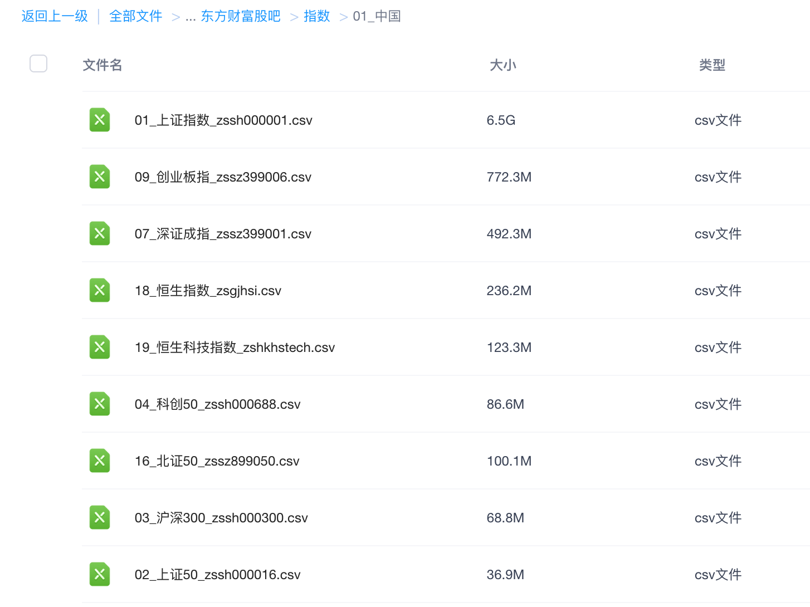
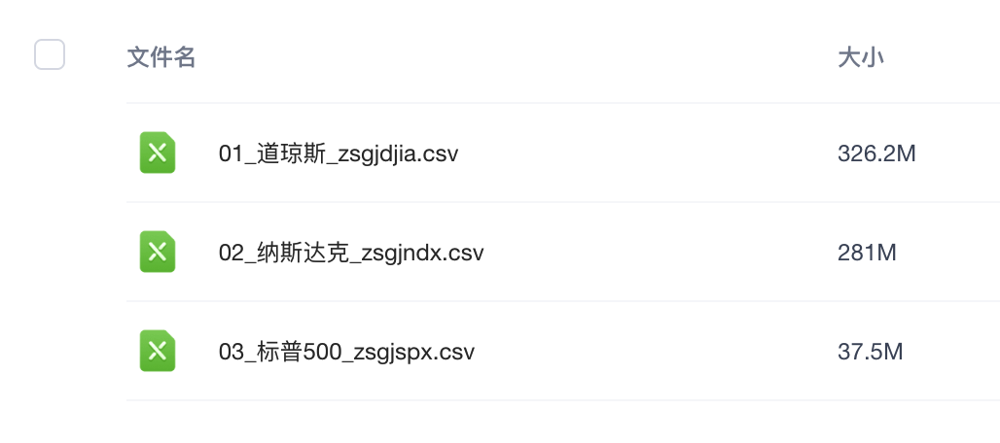
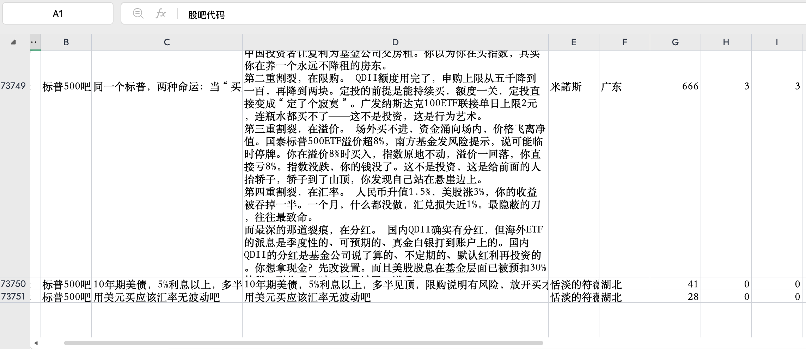
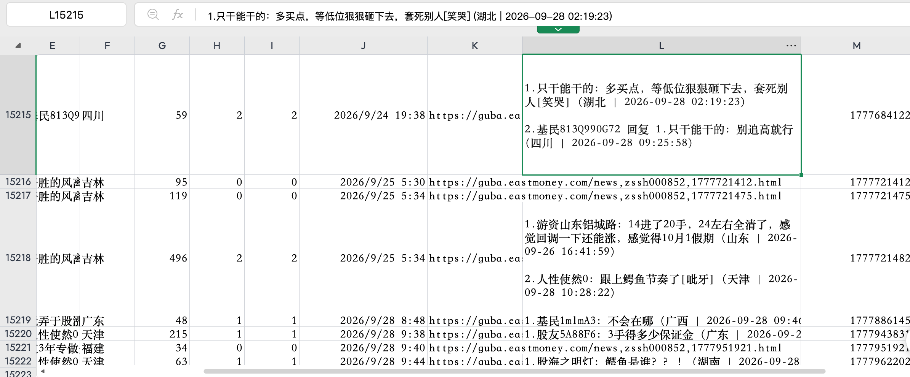

# 东方财富股吧帖子与评论数据合集

中国（含港股指数）、美国、德国、英国、日本五国完整合集，售价199元，所在地杭州。2026-10-06已上架，自动发货和成交后自动续售已启用。

[查看闲鱼商品](https://www.goofish.com/item?id=1088597030202)

## 标题

东方财富指数股吧帖子评论数据合集截至2026年9月30日

## 商品图片

### 1. 主图

### 2. 国内指数网盘目录

### 3. 美国指数网盘目录

### 4. 标普500股吧帖子正文样例

### 5. 中证1000股吧评论与回复样例

## 发布正文

东方财富指数股吧帖子＋评论数据合集，199元整包。

【数据内容】
约1418万帖、2597万条评论，含帖子正文、评论及回复。共25份CSV，约9.9GB，帖子截至2026年9月30日。

【覆盖范围】
中国（含港股）：19份，包含上证指数、沪深300、科创50、创业板指、恒生指数、恒生科技指数等。
美国：3份，道琼斯、纳斯达克、标普500。
德国：德国DAX30；英国：英国富时100；日本：日经225，各1份。

【数据字段】
共16个字段：
基础信息：股吧代码、股吧名称、帖子ID、帖子类型。
文本内容：标题、帖子正文、全部评论内容。
作者与时间：作者、地区、发布日期。
互动数据：阅读数、评论数、实收评论数。
相关链接：帖子链接、帖子图片链接、帖子附件链接。
一帖一行，正文与评论关联保存。

【适用用途】
市场情绪、投资者关注、事件舆情、关键词及文本分析，适合科研使用。

【交付与售后】
付款后自动发送百度网盘链接和提取码，不寄实物。文件较大，建议用Python/R读取。
虚拟数据资料可复制，非质量问题发货后不退不换，下单前请看好目录和样例。链接失效或无法下载可联系补发；资料与描述不符等质量问题联系处理。

## 发货配置

买家收到完整合集的百度网盘链接和提取码，以及下载、日期口径和CSV读取说明。私有链接只用于付款后的发货消息，公开商品正文不展示。

发货载荷在仓库外保存为 `CardCreate` 文本卡券，文件权限0600；商品档案的 `delivery.content_file` 指向该文件。线上文本卡券4已绑定商品1088597030202并启用，发货正文已回读核对一致。账号在线，发送资料成功后确认发货；实际订单发货尚待首笔成交验证。

## 内部核验记录

- [25份文件清单](files.csv)：按股吧入口登记日期、帖子数、评论数和字节数。
- [交付回执](delivery-manifest.json)：来自采集仓库2026-10-06已完成记录，远端核验为存在及字节数一致。
- [网盘目录读取](netdisk-directory.txt)：此前通过既有服务账号列出五个国家目录。
- [素材来源与哈希](image-prompts.json)：主图提示词及4张截图的来源、尺寸与哈希。原图直接复制，未改变正文、评论、文件名或数量。
- 国内/美国目录截图为部分文件展示，完整商品仍包含25份CSV。绘制的 `images/02-file-list.png` 留作内部清单预览，不进入商品图片顺序。
- 用户截图用于展示字段、帖子正文及评论回复形式，不以截图行号推算合集记录数；总量来自完整交付清单。
- 买家分享链接已保存；本次匿名提取码校验接口返回errno 9019，尚未完成买家下载访问验证。

## 上线记录

- 2026-10-06分类正文及网盘交付、售后说明已在当前商品原位更新；普通卖家网页编辑接口回读逐字一致，商品ID、售价、图片、地址与发货续售关联保持一致。核验记录见[平台正文更新](platform-edit.json)。
- 商品ID：1088597030202；素材ID：3；售价：199元；所在地：杭州；分类：电子资料。
- 主图及四张截图已发布，平台同步回读确认在售、价格及五张图片。
- 文本卡券4已绑定并启用，回读发货内容与私有载荷一致。
- 自动续售规则2处于监听中；成交并发货、确认旧商品不在售后，使用素材3重新发布并迁移发货关联。
- 沿用账号每日擦亮开关；列表回读has_card=true、is_polished=true，今天已擦亮。擦亮、日切换、自动续售调度配置均已启用，生产调度和消息服务健康。
- 实际成交发货、成交续售及跨日擦亮仍待对应业务事件验收。
- 本次发布批次：7106c4b7-9f0f-414f-baf2-d0faf7705f95；最后核验：2026-10-06T19:20:30+08:00。

## 资料边界

25个股吧不等于25种不同指数。CSV一帖一行，评论集中在一个文本字段，包含回复关系；不是每条评论一行，也不是评论结构化JSON。不同股吧起始日期不同，合集最早2010年不表示每个股吧都从2010年起。图片和附件为链接，数据包不包含另行承诺的分析结果或分析脚本。

## 数量与报价参考

[2026-10-06价格调查](../research/index-guba-pricing-2026-10-06.md)记录5项相关公开标价、交付类型差异与建议售价。历史建议价未采用；用户最终确定售价199元，已写入商品档案及线上商品。
