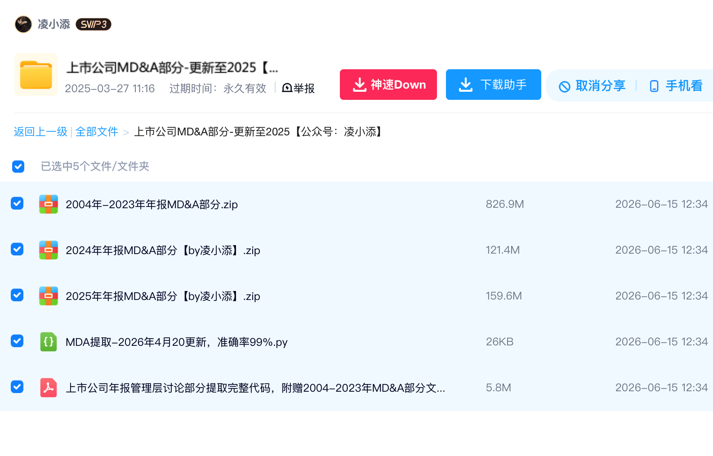
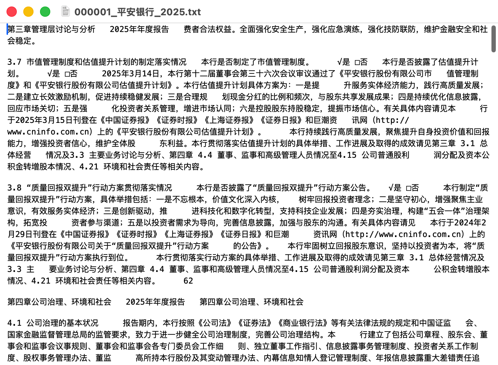

# 上市公司 MD&A 商品素材

商品标题、完整描述和正式售价统一维护在 [product.json](product.json)。本页是素材导航与核验记录，不另设一套商品字段。

按更新后的 `visual-promotion-design` Skill核对交付清单、商品文案、展示图与发货消息。用户认可白底、蓝黑文字的简约扁平主图，并明确要求封面不显示价格。本商品包含MD&A文本资料、提取Python脚本与配套PDF说明，一并交付；不突出词频、语调或相似度等分析功能。

## 展示顺序

| 顺序 | 图片 | 解决的问题 | 来源 |
| --- | --- | --- | --- |
| 1 | [主图](images/01-main-centered.png) | 卖什么、更新至哪个报告年度 | 内置image_gen；保留认可风格，不显示价格或分析功能标签 |
| 2 | [网盘目录](images/02-netdisk.png) | 实际交付哪些文件 | 用户2026-10-04提供的网盘截图，原图直接使用 |
| 3 | [TXT正文样例](images/03-txt-sample.png) | 文本打开后是什么内容 | 用户提供的`000001_平安银行_2025.txt`截图，原图直接使用 |

生成与修订提示词、截图来源、尺寸与哈希见 [image-prompts.json](image-prompts.json)。两张截图直接复制，未裁切、改字或用AI重绘，文件哈希与用户提供的原图一致。旧用途图、交付图和目录渲染图保留为历史素材，不进入当前展示顺序。

## 样例与核验范围

现有三张素材已包含两张截图。网盘图展示三份年度ZIP、一个提取脚本和一个PDF；TXT图展示平安银行2025年报告章节片段。压缩包内文件目录、其他公司或年度样例可在取得来源素材后继续增加，不作为当前三张素材完成的前置条件。

TXT截图底部可见“第四章公司治理、环境和社会”，样例跨出了管理层讨论与分析章节；保留原貌，正文说明样例有相邻章节片段，并保留提取边界核验事项，不据此宣传纯净提取。截图中的换行、分页与排版也按原图展示，不把截图当成全量资料已校验的证明。

## 事实与完成范围

用户确定售价，并说明更新至2025年；本地按报告年度表达。分享提取码校验成功，目录读取成功，确认有五项文件：三个标注2004–2023、2024、2025年MD&A的ZIP，一个Python提取脚本，一个PDF说明。CSV保留原始文件名和字节大小。公开素材不包含下载地址、提取码、Cookie或账号凭据。

三个ZIP合计约1.16GB。已读取目录并查看用户提供的TXT截图，未下载全包、解压核验完整内容，也未运行脚本。年份属于目录标签，不能据此推断每年全市场完整覆盖。脚本文件名里的“准确率99%”仅作为原始文件名出现在网盘截图中，不是已核验的准确率承诺。

实际文本发货载荷保存在仓库外，`product.json.delivery.content_file`引用其路径。卡券正文已回读核对与本机载荷一致，公开档案不保存下载地址及提取码。

## 首次线上发布与交付记录

核验时间：2026-10-04T16:48:13+08:00。商品[2004-2025上市公司年报MD&A文本附提取脚本](https://www.goofish.com/item?id=1088110202839)已发布，售价49.9元、所在地杭州、分类电子资料；三张图片由平台商品列表同步回读确认。批量任务`3b2a20d0-2aad-43df-ad45-e9bd6a7fc685`已完成，发布成功1件、失败0件，商品自动同步成功。

素材ID 2、商品ID 1088110202839、文本卡券ID 3。卡券已绑定并启用；生产websocket使用实际发货匹配器查询，唯一匹配到启用的自有文本卡券3。账号启用`send_before_confirm`与`auto_confirm`：买家付款后发送链接及提取码，发送成功后确认发货。`confirm_before_send`、`only_send_card`与`scheduled_redelivery`保持关闭。既有商品的卡券关联未改动。

自动续售规则ID 1已启用并处于监听中，关联本商品、素材2及卡券3，延迟采用后端默认60秒。生产scheduler扫描任务已启用且运行；自动发货成功后，若旧商品已不在售，会重新发布并迁移卡券关联；旧商品仍在售时等待。账号订单总数0，尚无实际付款、链接送达及成交续售验收。

### 每日自动擦亮

2026-10-04已启用账号`3073157444_1`的`auto_polish`。生产擦亮任务及日切换任务均启用、运行，沿用既有60秒扫描间隔；按北京时间每日重置已擦亮状态，随后擦亮当天未处理的商品。同账号后续新上架及自动续售生成的商品也会加入。

执行批次`634aba58-d8d8-41cb-aec9-572a715f6f4e`记录本商品于16:53:01擦亮成功，商品列表回读`is_polished=true`。同批次历史Kimi商品`1082100512426`因已下架返回不支持操作；调度仍会扫描这条历史目录记录，不影响本商品的擦亮成功。

如需关闭自动擦亮，调用`PUT /api/v1/cookies/3073157444_1/auto-polish`，请求`{"auto_polish":false}`，恢复本次变更前的账号值。全局擦亮与日切换配置未修改。

### 撤销本次配置

通过CLI先用`publish relist set 2 --data '{"enabled":false}'`关闭本素材续售，再用`items offline 3073157444_1 --item-id 1087215043943`下架当前商品，`cards disable 3`停用发货卡券。若恢复本次变更前的账号策略，用`delivery switch 3073157444_1 auto_confirm false`及`delivery switch 3073157444_1 send_before_confirm false`。只在仍为本次配置且没有后续业务调整时恢复原值，保留发布记录及商品ID。

### 主图居中修正

2026-10-04修正主图偏上、顶部文字易裁切的问题：标题、日期与文档图标作为整体水平、垂直居中，上下留白均衡。新图为`images/01-main-centered.png`，商品档案与展示顺序已更新；`images/01-main.png`保留为历史原版，修正版已随后发布上线。两张原始截图不变。

### 修正版线上发布与下架完成

2026-10-04新版[MD&A商品](https://www.goofish.com/item?id=1087215043943)已发布为`1087215043943`。本项目当时接入的原位编辑接口仅支持鱼小铺，本次采用重新发布路径，商品链接发生变化。主图从平台下载回读并查看，与居中修正版一致；平台将PNG转为JPEG，不能按文件哈希相等验收。售价49.9元、杭州、正文、截图和交付内容保持原样；卡券3已绑定新版，自动续售规则1的`current_item_id`已更新，账号自动发货和每日擦亮均保持启用。

旧商品`1088110202839`已于2026-10-04T17:26:03+08:00通过CLI成功下架。最初失败是项目误用鱼小铺批量接口；后端1.1.5改为官网普通卖家下架接口，网页版和CLI共用这次修复。平台在售列表回读只有新版`1087215043943`，共1件且无下一页，主图替换完成。旧商品的本地记录、发货关联和历史保留。新商品卡券3启用，自动发货、续售和每日擦亮配置均再次回读确认，账号仍在线；实际成交发货与续售仍待真实订单验收。

### 2026-10-05 自动擦亮判定修复

用户在闲鱼App手动擦亮后，按钮变为“今日已擦亮”，说明早先仅凭接口调用成功认定自动擦亮完成的验收不足。核对原始回包：00:01:15返回`SUCCESS`，但商品仍为`canPolish=true`；旧程序的请求URL为1.0、参数v为2.0，且立即设置了当天已完成状态。

生产1.1.6统一URL与参数版本为1.0；调用成功但没有平台完成状态时保留待处理。平台明确返回已擦亮时记录“本次未重复擦亮”，不当作新执行一次。9项相关测试通过，scheduler与后端健康、源文件哈希匹配；消息/自动发货服务未重启，账号业务开关未修改。

只对本商品重新核对处理标记，随后正常60秒调度于22:57:23记录“平台确认今日已擦亮（本次未重复擦亮）”，批次`d27dd508-4fec-4793-add4-04621075c042`、日志33；本地完成标记已恢复。今天的App手动擦亮由用户完成，本次线上验证确认了正常调度及完成判定，没有冒充新的自动擦亮。跨日后下一次自动擦亮的App效果尚未验收。
